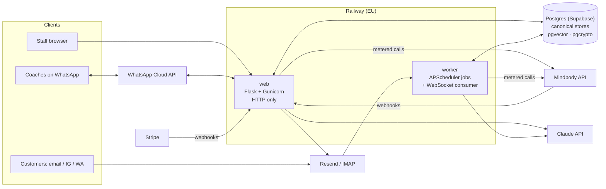

# Core: operations platform for boutique fitness studios

> **The source code is private.** Core is a live commercial product that handles studio and customer data. This repo is a write-up of what it does, how it's built and why. I'm happy to walk through the real code in an interview.

Core runs the day-to-day operations of a group of boutique fitness studios in Switzerland: class scheduling, coach shifts and substitutions, a customer inbox with AI-drafted replies, a WhatsApp assistant for staff, finance and month-end close, and partner-portal integrations. It started as an internal tool and is now a **multi-tenant SaaS** with per-tenant billing.

I designed, built and run it: product, architecture, code, infrastructure and operations.

<!-- TODO: add 3–4 screenshots with any personal data removed (Schedule calendar, Inbox, Finance, WhatsApp flow) -->

---

## At a glance

| | |
|---|---|
| **Started** | April 2026, in production since its first weeks |
| **Size** | ~127k lines of Python app code · ~115k lines of tests (~6,400 test functions) |
| **Data** | Postgres (Supabase) · 210+ versioned SQL migrations |
| **Decisions** | 20 written Architecture Decision Records |
| **History** | ~3,700 commits |
| **Users** | Studio managers, front desk, coaches (web + WhatsApp), an external accountant |

**Stack:** Python 3.13 · Flask (blueprints) · Gunicorn · PostgreSQL / Supabase (psycopg 3, pgvector, pgcrypto) · APScheduler · React 19 + TypeScript + Vite (one "JS island") · Railway (EU region) · Sentry · GitHub Actions

**Integrations:** Mindbody Public API v6 + webhooks · Meta WhatsApp Cloud API · Anthropic Claude (tool use, RAG) · Voyage embeddings · Stripe · Resend · IMAP/SMTP · GoHighLevel CRM · Google APIs · Swiss QR-bill and insurance-invoice XML formats

---

## The problem

Studios run on Mindbody, a widely used booking platform. It's powerful but slow to operate for many daily tasks: building a weekly class schedule, finding a substitute when a coach is sick, answering the same customer questions across email, Instagram and WhatsApp, or reconciling revenue at month end. Each of these was manual, error-prone and spread across several tools.

Core puts those workflows on one surface and writes back to Mindbody, so staff rarely need to open its admin console.

## What it does

| Area | What it does |
|---|---|
| **Schedule** | Build a weekly coach grid and publish it to Mindbody; edit, delete and substitute classes (including from a photo of a paper schedule, parsed by an LLM); a read-only coach calendar |
| **Shift subs** | A coach reports an absence, colleagues get a link to claim the shift, and Mindbody is updated automatically. Managers get a console and escalation emails |
| **"Sasha" WhatsApp assistant** | A 1:1 assistant on the WhatsApp Cloud API. Coaches ask for their schedule, report absences, take shifts back or browse open offers in plain language |
| **Inbox** | One inbox for email, Instagram and WhatsApp, with AI-drafted replies grounded in a retrieval knowledge base built from past replies |
| **Web agent** | A Claude tool-use assistant that can look up and change Mindbody data for staff. Every write needs explicit confirmation |
| **Finance** | Revenue report, deferred-revenue recognition, a monthly close with frozen snapshots, and reconciliation checks. Used directly by the external accountant |
| **Invoicing** | Swiss QR-bill invoices and health-insurance invoices in a regulated XML format, plus a public, token-authenticated customer form |
| **Analytics** | Cohort, LTV, funnel and tenure dashboards, plus an "Action Center" listing members who need attention |
| **Operations** | Checklists, tickets, staff resource pages, partner-portal auto-activation, background jobs |
| **Platform** | Tenant management, per-tenant feature enablement, usage metering, Stripe-driven suspension and reactivation |

---

## Architecture

- **Feature apps as Flask blueprints**, organised in three layers: `programs/*` (features), `integrations/*` (external API clients) and `shared/*` (database, auth, mail, access policy). Programs may import from integrations and shared, never from each other. **A test enforces this boundary.**
- **Web/worker split.** The web service only serves HTTP. Background jobs (~80 scheduled jobs, email sync, partner WebSocket) run in a separate worker service from a single job registry. Local development runs both in one process behind a file lock.
- **Multi-tenancy.** A tenant layer sits above studios. A user's access is the access policy (defined in code) combined with what their tenant has enabled. Studio API credentials are encrypted in the database with `pgcrypto`.
- **One "JS island".** The CRM is a React/TypeScript app mounted inside the Flask app. The rest of the UI is server-rendered Jinja. There's deliberately no separate dev server, so the local Content Security Policy matches production.

---

## Engineering decisions worth talking about

Each of these has a written ADR covering context, decision and consequences.

**1. Local canonical stores before API calls.** Every Mindbody API call costs money and is rate-limited. Features read from local Postgres stores that are kept current by **free webhook deliveries**, with a periodic backstop sync to catch missed events. Polling is the last resort and needs a load estimate first. Every outbound call is counted per feature, so a cost regression shows up on a dashboard the day it ships.

**2. The access policy lives in code, not in a table.** Role-to-permission grants, plus employment-status gates, are defined in one Python module. The admin UI shows the policy read-only. Changing access means a reviewed code change and a deploy, not a database edit nobody can audit.

**3. LLM writes always confirm.** The tool-use agent can change real bookings and schedules, so every write tool proposes an action and waits for the human to confirm. The WhatsApp assistant's write inputs are echoed back before execution. Model choices are A/B tested per surface on real cases, and each surface's cost is metered.

**4. Retrieve-then-judge for grounded replies.** Inbox drafts are grounded in an FAQ and a knowledge base of past replies. The feature was switched on but silently doing nothing, for two reasons. First, an IVFFlat index on a small table probed one empty cluster and returned zero rows. Second, a fixed similarity cutoff discarded the best match, which scored 0.43 while containing the exact answer. The fix: an HNSW index (high recall without tuning) plus retrieving the top candidates and letting an LLM judge decide relevance, instead of a brittle threshold.

**5. One canonical store per fact.** Two features answered "how many classes has this member done?" differently. Almost a third of members disagreed, because two tables were built from different sync histories. Each business fact now has exactly one owning table, and every feature reads from it.

**6. Fail closed on missing configuration.** Webhook endpoints reject unsigned or unverifiable requests (Stripe, Resend/Svix, WhatsApp bridge) rather than accepting them. An integration whose credentials aren't set is turned off everywhere, not half-working.

---

## Quality and guardrails

- **~6,400 tests** run on every push (pytest against a real Postgres in CI). Production deploys only ship commits whose CI is green.
- **Architecture as tests.** Besides behaviour tests, CI enforces:
  - import boundaries between layers
  - design-system rules (no raw colours, no inline event handlers, a CSP nonce on every inline script)
  - documentation size limits, plus a rule that every feature flag read in code is documented
- **Feature flags** for anything risky, each documented with its reasoning, cost and production state. Flags are retired once a feature settles.
- **Runbooks** for recurring incidents (expired API tokens, a scheduler that didn't fire, an undelivered reply, a finance check that stays red) so diagnosis doesn't depend on memory.
- **Observability.** Sentry (EU ingest) with alerts that name the affected record and the fix, not just a count. Uptime monitoring, and audit tables for every outbound email and WhatsApp message with delivery status updated from webhooks.

## Security and privacy

- Secure headers (CSP with per-request nonces, HSTS, frame protection) and HTTPS only
- Secrets only in environment variables; per-studio third-party credentials encrypted at rest
- Parameterised SQL throughout (psycopg 3)
- Magic-link and token pages for coaches and customers, with tokens never stored in message bodies or logs
- Built for GDPR / Swiss FADP: minimal PII, EU hosting for the app and database, and filters that stop sensitive fields from third-party systems being copied into Core

---

## How I work

I built Core **AI-assisted**: most code was written by pairing with Claude Code, with me owning the product decisions, architecture, review, testing and operations. Making that work well at this scale became a significant part of the engineering:

- the repo is documented for agents as well as humans: a root index, a short doc for each module, ADRs and runbooks
- standards are encoded as CI checks rather than conventions, so AI-written changes are held to the same rules as hand-written ones
- prompt and model changes are verified with live probes and A/B tests, not assumed

## What I'd like to discuss

- Designing around a metered, rate-limited third-party API (webhooks, canonical stores, backstops)
- Making LLM features safe to put in front of non-technical staff
- Running a production SaaS as a solo engineer: deploy gating, observability, incident runbooks
- Moving from single-tenant to multi-tenant without a rewrite

---

<!-- TODO: contact line -->
**Contact:** [your email] · [LinkedIn]
